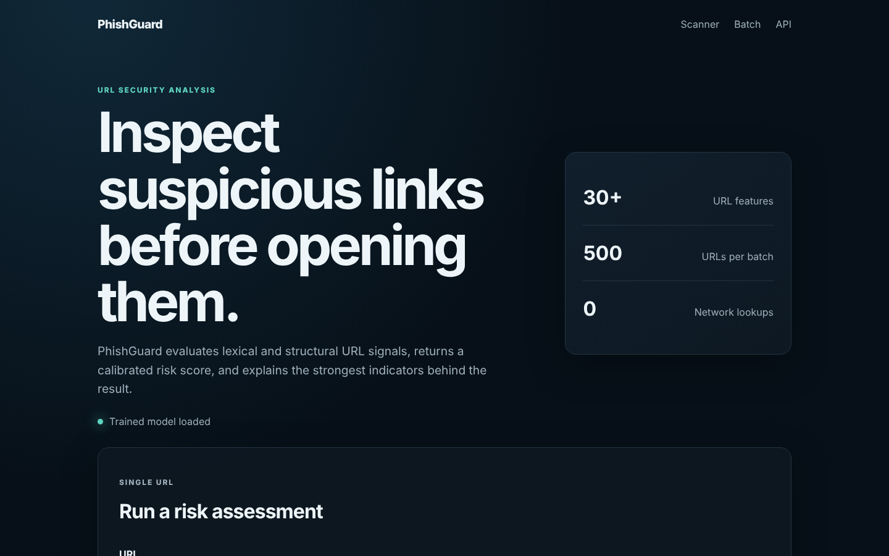
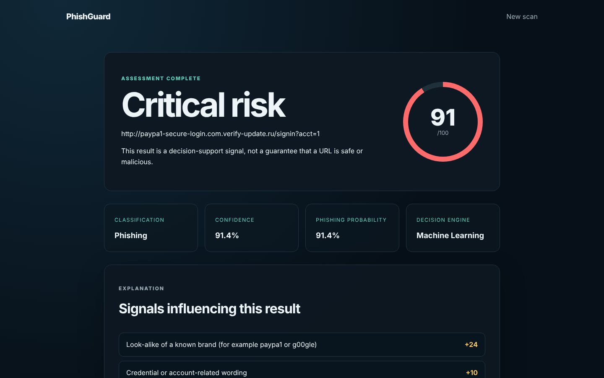

# PhishGuard

PhishGuard is a Flask application for assessing phishing risk from the lexical and structural characteristics of a URL. It provides single-URL analysis, batch CSV processing, a JSON API, risk explanations, and an optional scikit-learn training pipeline.

The application does not visit submitted websites or perform DNS, WHOIS, certificate, or reputation lookups. This keeps analysis deterministic and avoids contacting potentially malicious hosts.
**Live demo:** https://phishguard-fjyt.onrender.com (free hosting; the first load can take up to a minute)
## Screenshots

**Scanner home**



**Result for a look-alike PayPal URL, with the signals behind the score**



## Capabilities

- Extracts more than 30 URL features, including hostname entropy, domain structure, encoding, suspicious terms, IP-based hosts, shortened links, and path depth.
- Returns a classification, phishing probability, confidence value, and 0–100 risk score.
- Explains the strongest indicators contributing to a result.
- Supports CSV uploads and JSON batches of up to 500 URLs.
- Ships a trained scikit-learn model (Random Forest, F1 0.71 on holdout) and loads it automatically.
- Uses a documented heuristic fallback when no trained model is present.
- Includes security headers, input-size limits, Docker support, tests, and GitHub Actions CI.

## Architecture

```text
Browser / API client
        |
        v
Flask routes and validation
        |
        v
URL normalization and feature extraction
        |
        +-----------------------------+
        |                             |
        v                             v
Persisted ML model             Heuristic fallback
        |                             |
        +-------------+---------------+
                      v
          Risk score and explanation
```

## Project structure

```text
.
├── app.py                     # Application factory and security headers
├── api_routes.py              # Web, batch, health, and prediction endpoints
├── feature_extractor.py       # Deterministic URL feature engineering
├── ml_pipeline.py             # Training, persistence, inference, and fallback logic
├── templates/                 # Server-rendered interface
├── static/                    # CSS and JavaScript
├── tests/                     # Route and feature tests
├── models/                    # Optional persisted model artifacts
├── .github/workflows/ci.yml   # Automated linting and tests
├── Dockerfile
├── docker-compose.yml
└── pyproject.toml
```

## Run locally

Python 3.11 or newer is required.

```bash
git clone https://github.com/shreyaaaalankaaa/PhishGuard.git
cd PhishGuard
python -m venv .venv
```

Activate the environment:

```bash
# macOS or Linux
source .venv/bin/activate

# Windows PowerShell
.venv\Scripts\Activate.ps1
```

Install dependencies and start the server:

```bash
pip install -r requirements.txt
python app.py
```

Open `http://localhost:5000`.

## Docker

```bash
docker compose up --build
```

The application will be available at `http://localhost:5000`.

## API

### Single prediction

```bash
curl -X POST http://localhost:5000/api/predict \
  -H "Content-Type: application/json" \
  -d '{"url":"http://198.51.100.42/verify-account/login"}'
```

### Batch prediction

```bash
curl -X POST http://localhost:5000/api/predict/batch \
  -H "Content-Type: application/json" \
  -d '{"urls":["https://github.com","http://198.51.100.42/login"]}'
```

### Health check

```bash
curl http://localhost:5000/api/health
```

Additional examples are available at `/docs` when the application is running.

## Shipped model and how it was trained

A fresh clone now scores URLs with a trained Random Forest (`models/phishguard.joblib`, about 11 MB). The heuristic is the fallback if the file is missing or was trained on a different feature set.

**Data.** I used a 75,000-URL training set:

- 60,000 URLs sampled from the public [faizann24 malicious-URL dataset](https://github.com/faizann24/Using-machine-learning-to-detect-malicious-URLs) (`data/data.csv`, labels good/bad).
- Plus 15,000 legitimate URLs built from the [top 15,000 domains](https://github.com/zer0h/top-1000000-domains) (homepages, login, help, docs and search pages).

The extra legitimate sites are needed because in that dataset short bare domains are mostly malicious. Trained on it alone, the model learned "short URL = phishing" and flagged `github.com`.

**Results** (25% stratified holdout):

| Engine | Precision | Recall | F1 | ROC-AUC |
| --- | --- | --- | --- | --- |
| Heuristic fallback | 0.96 | 0.05 | 0.10 | n/a |
| Random Forest (shipped) | 0.63 | 0.82 | 0.71 | 0.95 |

On 3,000 further popular domains that were never used in training, the model wrongly flagged 41 (1.4%). The full numbers are in `models/evaluation.json`.

**Look-alike domains.** The `brand_lookalike` feature undoes common character swaps (`paypa1` → `paypal`, `g00gle` → `google`) and catches brands padded with words on someone else's domain (`secure-paypal-login.com`). Public datasets have few of these, so a look-alike brand or an IP-address host is a *hard signal*: the score is never lower than the heuristic's score for that URL.

**Retrain it yourself:**

```bash
git clone --depth 1 https://github.com/faizann24/Using-machine-learning-to-detect-malicious-URLs.git /tmp/urldata
git clone --depth 1 https://github.com/zer0h/top-1000000-domains.git /tmp/topdom
python scripts/evaluate_model.py /tmp/urldata/data/data.csv --sample 60000 \
    --legit-domains /tmp/topdom/top-100000-domains
```

You can also train from Python with `pipeline.train_model(urls, labels)`. The pipeline compares logistic regression, Random Forest and histogram gradient boosting with stratified 5-fold cross-validation, keeps the best F1, and saves the model to `models/`.

These metrics describe this dataset only. Real-world phishing changes quickly, so treat the score as one signal, not a verdict.

## Testing

```bash
pip install pytest ruff
ruff check .
pytest -q
```

## Security and limitations

PhishGuard evaluates URL text only. It cannot verify page content, redirects, domain ownership, certificate history, hosting reputation, or newly registered domains. HTTPS is not treated as proof of legitimacy, and a low score does not guarantee safety.

Do not use this project as the sole basis for blocking access, reporting a domain, or making high-impact security decisions. A production system should combine lexical analysis with reputation feeds, DNS and registration signals, page-content analysis, sandboxing, monitoring, and human review.

## Author

**Shreya Lanka**  
Cybersecurity undergraduate interested in security engineering, machine learning, and software development.

- GitHub: `shreyaaaalankaaa`
- LinkedIn: `shreya-lanka-057a0b28a`
